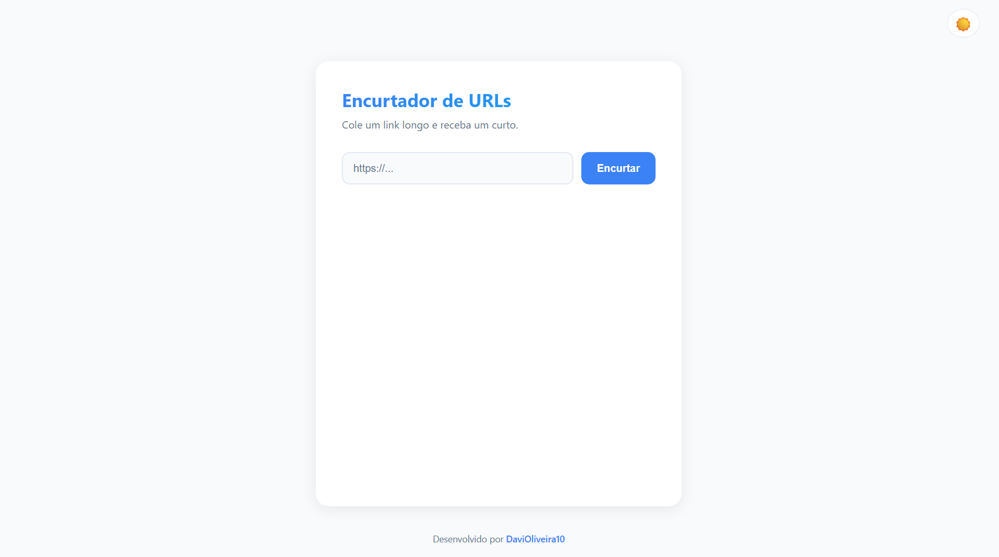
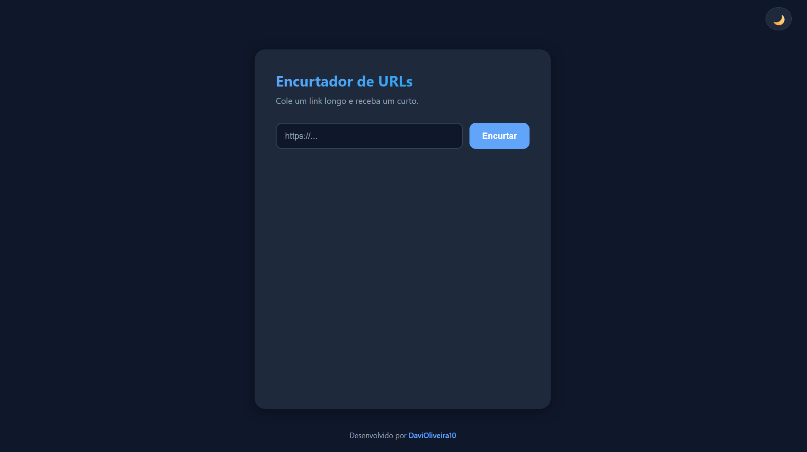
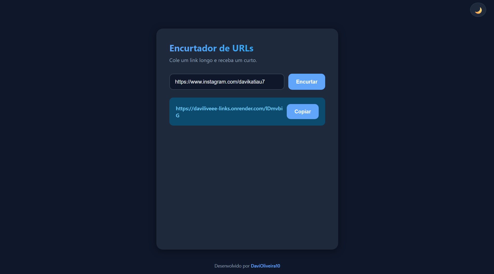
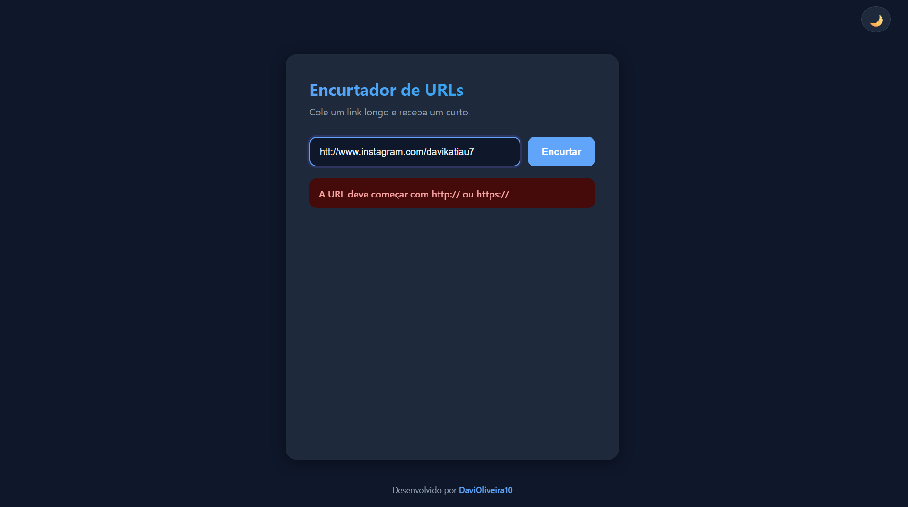

# Encurtador de URLs


Aplicação web que transforma links longos em links curtos, redireciona os acessos e conta os cliques de cada um. Projeto de portfólio feito com Java 25 e Spring Boot, com API REST, interface web, testes automatizados e deploy em nuvem.

**Demonstração online:** https://daviliveee-links.onrender.com

> O projeto roda em hospedagem gratuita, que coloca o app para dormir após cerca de 15 minutos sem acessos. Por isso, o primeiro acesso pode levar cerca de dois minutos para abrir. Depois disso, ele responde normalmente.

## Telas

A interface tem modo claro e modo escuro.

| Modo claro | Modo escuro |
|---|---|
|  |  |

| Link gerado | Validação de URL |
|---|---|
|  |  |

## Funcionalidades

- Encurtar uma URL pela interface web ou pela API REST
- Redirecionamento com HTTP 302 e contagem de cliques a cada acesso
- Consulta de estatísticas de cada link (URL original, cliques e data de criação)
- Validação da URL: apenas `http` e `https`, host válido, tamanho máximo de 2048 caracteres e bloqueio de links para o próprio site
- Códigos aleatórios de 7 caracteres (Base62), únicos e imprevisíveis
- Respostas de erro padronizadas em JSON
- Esquema do banco versionado com Flyway

## Tecnologias

| Camada | Tecnologia |
|---|---|
| Linguagem | Java 25 |
| Framework | Spring Boot 4.1 (Web MVC, Data JPA, Validation, Actuator) |
| Interface | Thymeleaf |
| Banco de dados | MySQL (Aiven em produção) |
| Migrações | Flyway |
| Testes | JUnit, Mockito |
| Empacotamento | Docker (build em duas etapas) |
| Hospedagem | Render (aplicação) e Aiven (banco) |

## Como usar a API

**Criar um link curto**

```bash
curl -X POST https://daviliveee-links.onrender.com/api/links \
  -H "Content-Type: application/json" \
  -d '{"url": "https://www.youtube.com/"}'
```

Resposta (`201 Created`):

```json
{
  "codigo": "x7Kp2Ab",
  "linkCurto": "https://daviliveee-links.onrender.com/x7Kp2Ab",
  "urlOriginal": "https://www.youtube.com/"
}
```

**Acessar o link curto:** `GET /{codigo}` responde `302` e redireciona para a URL original, somando um clique.

**Consultar estatísticas:** `GET /api/links/{codigo}/stats`

```json
{
  "codigo": "x7Kp2Ab",
  "urlOriginal": "https://www.youtube.com/",
  "cliques": 14,
  "criadoEm": "2026-10-16T14:30:00"
}
```

**Erros:** URL inválida retorna `400` e código inexistente retorna `404`, ambos com um JSON no formato:

```json
{
  "status": 400,
  "erro": "URL inválida",
  "mensagem": "A URL deve começar com http:// ou https://",
  "timestamp": "2026-10-16T14:30:05"
}
```

## Decisões técnicas

- **Redirecionamento 302, e não 301.** O 301 é guardado em cache pelo navegador, e os cliques seguintes não chegariam ao sistema, o que quebraria a contagem.
- **Contador atualizado direto no banco.** O incremento é um `UPDATE ... SET cliques = cliques + 1`, e não uma leitura seguida de gravação no Java. Assim, acessos simultâneos não perdem contagem.
- **Código gerado com `SecureRandom`.** Evita que alguém deduza o próximo código a partir dos anteriores. Colisões são tratadas por uma restrição `UNIQUE` no banco e por novas tentativas.
- **Esquema controlado por migrações.** O Flyway cria as tabelas e o Hibernate apenas valida (`ddl-auto=validate`), mantendo banco local e de produção iguais.
- **Segredos fora do código.** Credenciais do banco são lidas de variáveis de ambiente em produção, e a configuração local fica fora do Git.

## Como rodar localmente

**Pré-requisitos:** Java 25 e MySQL.

1. Clone o repositório:
   ```bash
   git clone https://github.com/DaviOliveira10/encurtador-urls.git
   cd encurtador-urls
   ```
2. Crie o banco:
   ```sql
   CREATE DATABASE encurtador CHARACTER SET utf8mb4 COLLATE utf8mb4_unicode_ci;
   ```
3. Crie o arquivo `src/main/resources/application-dev.properties` (ele é ignorado pelo Git) com os dados do seu MySQL:
   ```properties
   spring.datasource.url=jdbc:mysql://localhost:3306/encurtador?serverTimezone=America/Sao_Paulo
   spring.datasource.username=SEU_USUARIO
   spring.datasource.password=SUA_SENHA
   ```
4. Execute:
   ```bash
   ./mvnw spring-boot:run
   ```
5. Abra http://localhost:8080. As tabelas são criadas automaticamente pelo Flyway.

## Testes

```bash
./mvnw test
```

Cobrem o gerador de códigos (tamanho, alfabeto e unicidade) e as regras do serviço com Mockito: validação de URL, tratamento de colisões de código e bloqueio de links para o próprio site. O teste de contexto do Spring exige o MySQL local configurado.

## Estrutura do projeto

```
src/main/java/com/davi/encurtador
├── controller   Interface web, API REST e redirecionamento
├── service      Regras de negócio e geração de códigos
├── repository   Acesso ao banco (Spring Data JPA)
├── model        Entidade Link
├── dto          Objetos de entrada e saída da API
└── exception    Exceções e tratamento global de erros
src/main/resources
├── db/migration Migrações do Flyway
└── templates    Páginas Thymeleaf
```

## Deploy

A aplicação é empacotada com o `Dockerfile` do repositório e roda no **Render**, conectada a um MySQL no **Aiven**. Em produção, o perfil `prod` lê as configurações de variáveis de ambiente:

| Variável | Descrição |
|---|---|
| `SPRING_PROFILES_ACTIVE` | `prod` |
| `DB_URL` | URL JDBC do banco, com `sslMode=REQUIRED` |
| `DB_USER` / `DB_PASSWORD` | Credenciais do banco |
| `APP_BASE_URL` | Endereço público do site, usado para montar o link curto |

## Próximos passos

- Contas de usuário com Spring Security e painel "meus links"
- Expiração opcional de links e limite de requisições por IP
- Documentação da API com OpenAPI/Swagger
- QR Code do link curto

## Autor

Feito por Davi.
